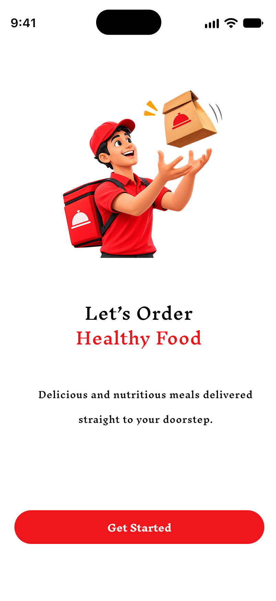
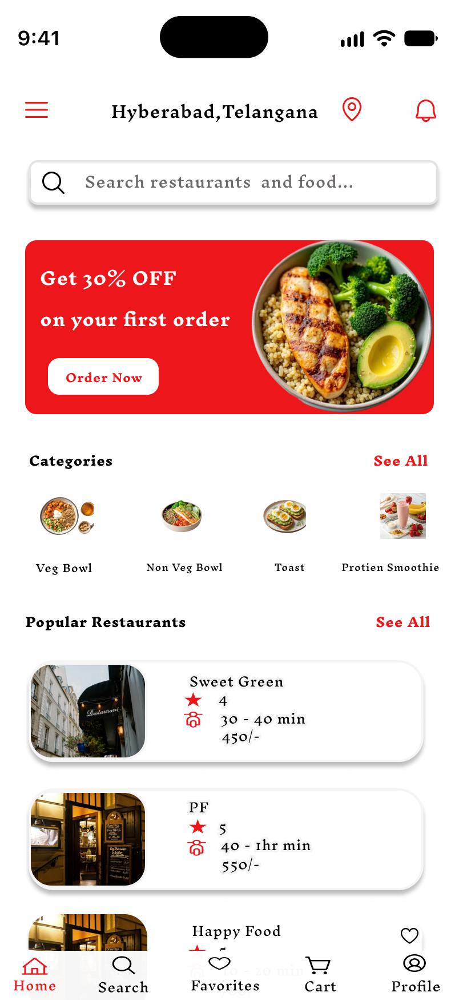
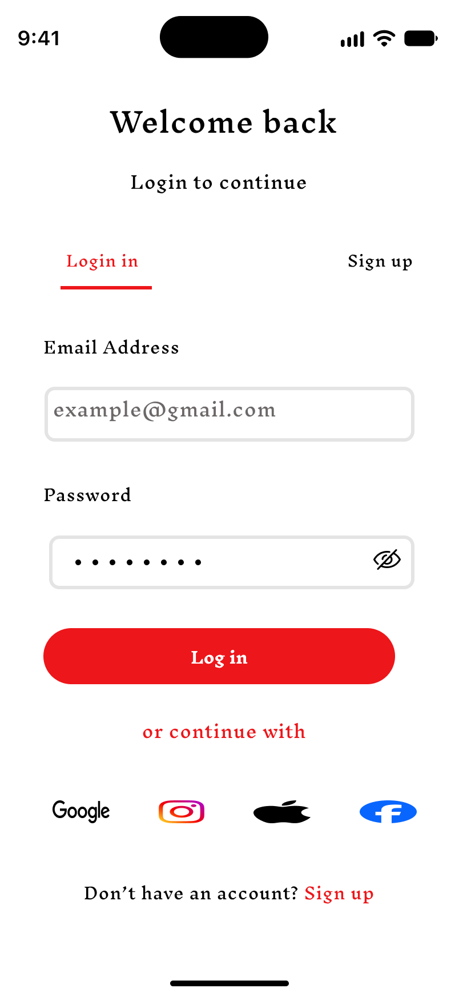
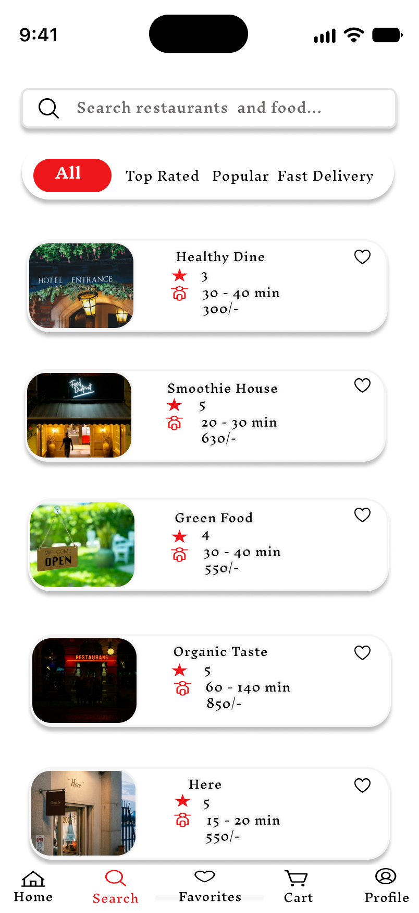
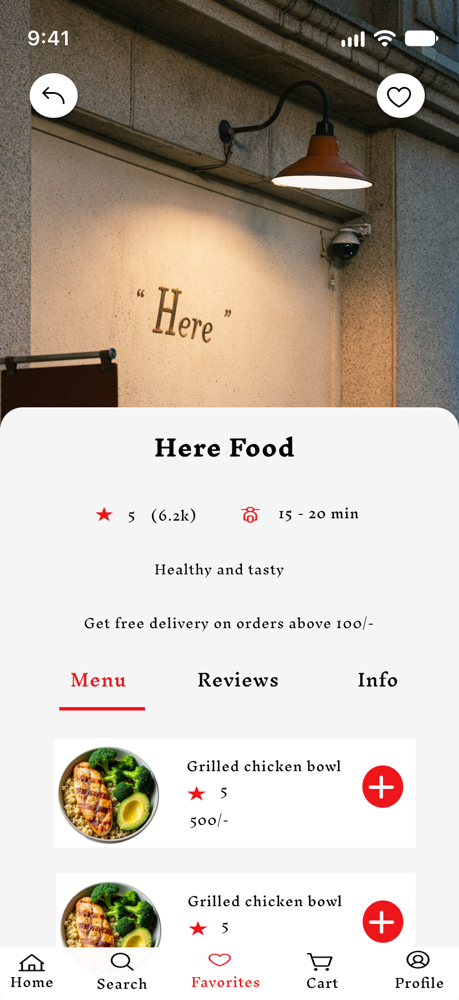
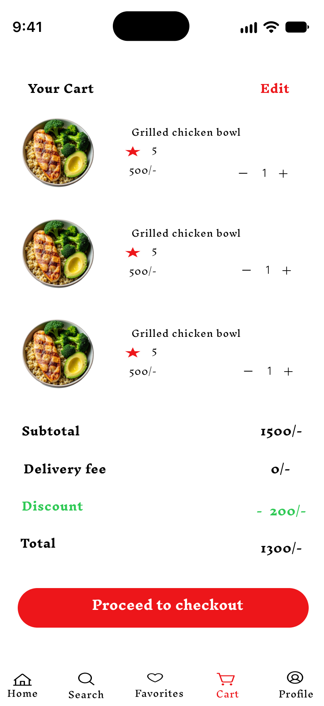
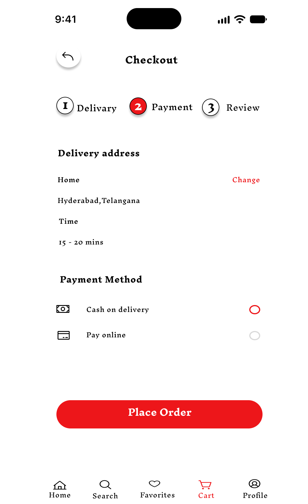
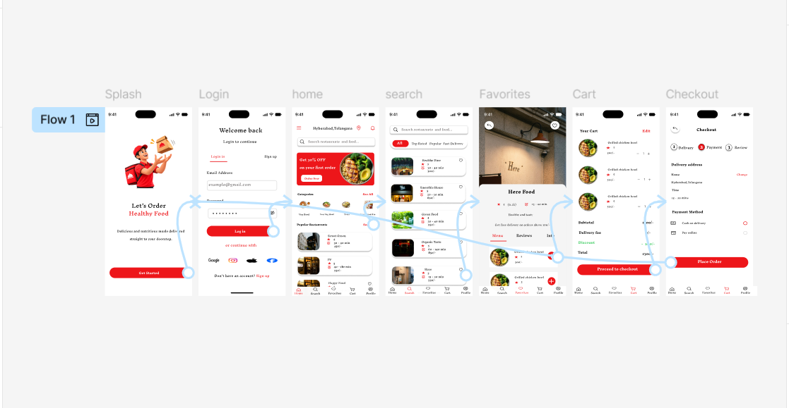

# Food Delivery App – UI/UX Design

## About the Project
The Food Delivery App is a modern mobile application design that helps users explore restaurants, browse food items, and order their favourite meals easily.

## Project Details
- Project Type: Mobile App UI/UX Design
- Tools Used: Figma, Lovable
- Design Focus: Mobile UI, User Experience, Responsive Design
- Role: UI/UX Designer

## Project Features
- Clean and modern mobile interface
- Restaurant and food browsing
- Food categories and menu sections
- Easy-to-use navigation
- User-friendly ordering experience

## Project Screenshots

## Project Screenshots

### Splash Screen

### Home Screen

### Login Screen

### Search Screen

### Favorites Screen

### Cart Screen

### Checkout Screen

### Prototype

## Live Project
View Live Food Delivery App – https://savor-flow-mobile-kitchen.lovable.app

## Portfolio
View My Portfolio – https://swethadevara.framer.website/
